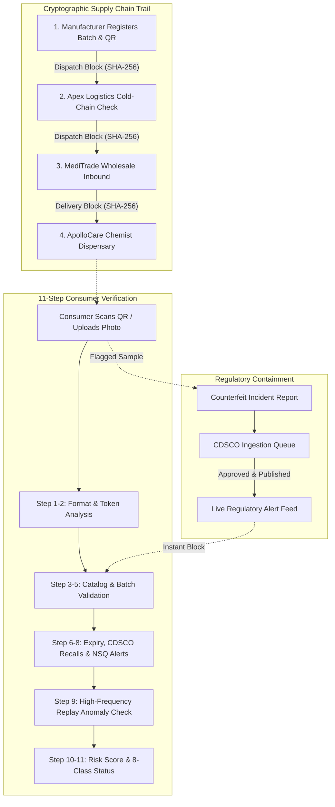

# 🛡️ MediSure AI — Pharmaceutical Traceability & Anti-Counterfeiting Platform

[](https://nextjs.org/)
[](https://react.dev/)
[](https://www.typescriptlang.org/)
[](https://fastapi.tiangolo.com/)
[](https://cdsco.gov.in/)
[](https://vercel.com/)

An end-to-end pharmaceutical provenance, verification, and regulatory compliance platform engineered for the Indian healthcare supply chain. Built for **PBL5 (Problem-Based Learning)**.

---

## 🚀 Live Demo & Quick Start

* **Live Web App**: Deployable to [Vercel](https://vercel.com/) in 1 click (see [Vercel Deployment Guide](#-deploying-to-vercel)).
* **Local Frontend**: `http://localhost:3000`
* **Local Backend API**: `http://127.0.0.1:8000` (Interactive Docs: `/docs`)

---

## 🌟 Key Highlights & Innovations

1. **Physical vs. Database Authenticity**: Differentiates between a QR code existing in a database vs. a physically verified, uncompromised product.
2. **Indian Regulatory Alignment**: Implements CDSCO Rule 96 (mandatory 2D Data Matrix on top 300 Indian medicine brands), Non-Standard Quality (NSQ) lab alert cross-referencing, and state drug controller licensing checks.
3. **Cryptographic SHA-256 Custody Ledger**: Genesis factory registration through distributor cold-chain transit to wholesale allocation and pharmacy receipt.
4. **11-Step Verification Protocol**: Multi-factor risk engine computing weighted scores ($0$–$100\%$) across 8 distinct status classifications.
5. **Interactive QR Code Generator Studio**: Live visual 2D barcode generator supporting direct verification URLs, GS1/CDSCO JSON payloads, high-res PNG downloads, and printable packaging labels.

---

## 🏛️ 7 Stakeholder Portals

| Role | Portal Path | Key Capabilities |
| :--- | :--- | :--- |
| **Consumer / Patient** | `/dashboard`, `/scan`, `/verify/[id]` | Scan packaging QR, upload blister photo with OCR, review 11-step audit logs, report counterfeits. |
| **Pharmaceutical Manufacturer** | `/company` | Register formulations, issue unique QR tokens, monitor replay attacks, log factory dispatches. |
| **Distributor / Logistics** | `/distributor` | Reconcile factory shipments, monitor cold-chain datalogger temperatures, sign custody blocks. |
| **Wholesaler / Stockist** | `/wholesaler` | Allocate stock to dispensaries, enforce automatic locks on expired or quarantined batches. |
| **Retail Chemist / Pharmacy** | `/pharmacy` | Audit dispensary shelf stock, receive pop-up CDSCO recall notices, one-click shelf quarantine. |
| **CDSCO Regulatory Reviewer** | `/reviewer` | Review government analyst lab reports, publish NSQ alerts, official Class I/II recalls. |
| **Platform Administrator** | `/admin` | System-wide surveillance metrics, monthly scan trend charts, stakeholder entity approvals. |

---

## 🔄 System Architecture & Verification Protocol



---

## 🧪 Demonstration Test Scenarios

Test these pre-seeded codes at `/scan` to evaluate different system behaviors:

| Code / Token | Medicine & Manufacturer | Scenario Behavior | Expected Result |
| :--- | :--- | :--- | :--- |
| `DOLO650` | Dolo 650 (Micro Labs) | Authentic batch, intact custody trail, verified CoA | `record_found` (Low Risk, ~5%) |
| `AUG625DUO` | Augmentin 625 Duo (GSK) | Authentic formulation, verified cold chain | `record_found` (Low Risk, ~8%) |
| `PAND001` | Pan-D Capsules (Alkem) | Expired shelf-life (31 Dec 2024) | `expired` (Medium Risk, 62%) |
| `TELMA40` | Telma 40 (Glenmark) | Active CDSCO Class II dissolution stability recall | `recalled` (High Risk, 95%) |
| `AZITH500` | Azithral 500 (Alembic) | Visual packaging defect / typography anomaly | `suspicious` (Medium Risk, 48%) |
| `SHELCAL500` | Shelcal 500 (Torrent) | Token scanned 184 times across different cities | `suspicious` (Replay Alert, 78%) |
| `UNKNOWN` | Unregistered Code | Token not found in CDSCO / manufacturer registry | `not_found` (High Risk, 100%) |

---

## 📦 Deploying to Vercel

The Next.js frontend is self-contained with internal App Router API route handlers, making it ready for instant Vercel deployment:

### Step 1: Push Project to GitHub
```bash
git init
git add .
git commit -m "feat: complete MediSure AI pharmaceutical traceability platform"
git branch -M main
git remote add origin https://github.com/<your-username>/<your-repo-name>.git
git push -u origin main
```

### Step 2: Import into Vercel
1. Go to [vercel.com/new](https://vercel.com/new) and log in with your GitHub account.
2. Select your repository and click **Import**.
3. In the **Configure Project** screen:
   - **Framework Preset**: `Next.js`
   - **Root Directory**: Click **Edit** and choose `frontend`.
4. Click **Deploy**!
5. Your live URL will be ready in under 2 minutes (e.g., `https://medisure-ai.vercel.app`).

---

## 💻 Local Development Setup

### 1. Prerequisites
- **Node.js**: v18+ (v20+ recommended)
- **Python**: v3.10+ (v3.11 recommended)
- **Git**

### 2. Frontend (Next.js)
```bash
cd frontend
npm install
npm run dev
# App runs at http://localhost:3000
```

### 3. Backend (FastAPI Python Service)
```bash
cd backend
python -m venv venv
# Windows:
venv\Scripts\activate
# macOS/Linux:
source venv/bin/activate

pip install -r requirements.txt
python -m uvicorn main:app --reload --port 8000
# API runs at http://127.0.0.1:8000 (Swagger docs at /docs)
```

---

## 📁 Repository Structure

```
d:\PBL5\
├── frontend/                 # Next.js 16 Web Application
│   ├── src/
│   │   ├── app/              # App Router Pages & API Route Handlers
│   │   │   ├── admin/        # Governance Portal
│   │   │   ├── company/      # Manufacturer Portal & QR Studio
│   │   │   ├── distributor/  # Logistics & Cold-Chain Hub
│   │   │   ├── wholesaler/   # Wholesale Stockist Hub
│   │   │   ├── pharmacy/     # Retail Chemist Dispensary
│   │   │   ├── reviewer/     # CDSCO Regulatory Reviewer Queue
│   │   │   ├── dashboard/    # Consumer Overview
│   │   │   ├── scan/         # Camera / Photo / Manual Scanner
│   │   │   ├── verify/[id]/  # 11-Step Verification Result & Audit Trail
│   │   │   ├── search/       # Public Medicine Catalog Search
│   │   │   ├── regulatory/   # Official CDSCO Recall & NSQ Feed
│   │   │   ├── safety/       # Consumer Packaging Safety Guide
│   │   │   ├── report/       # Counterfeit Incident Report Form
│   │   │   ├── history/      # Personal Scan History
│   │   │   └── api/          # Internal Serverless API Endpoints
│   │   ├── components/       # UI Components (Navbar, Footer, AuthGuard, QRCodeModal)
│   │   └── lib/              # Core Logic (verificationEngine.ts, demoData.ts, auth.tsx, api.ts)
│   └── package.json
│
├── backend/                  # FastAPI Python Service
│   ├── database.py           # SQLite connection & session
│   ├── main.py               # Application entrypoint & CORS
│   ├── models.py             # SQLAlchemy models
│   ├── schemas.py            # Pydantic validation schemas
│   ├── seed_data.py          # Real Indian pharma seed dataset
│   └── routers/              # API endpoints (auth, verify, medicines, reports, dashboard)
│
├── supabase/                 # Database Migrations & Seeds
├── WORKFLOW_AND_FEATURES.md  # Detailed Specification & Workflow Manual
├── .gitignore                # Comprehensive Git Ignore Rules
└── README.md                 # Project Overview & Deployment Manual
```

---

## ⚖️ Non-Affiliation & Regulatory Disclaimer

*MediSure AI is an academic and educational engineering prototype developed for PBL5. Demonstration data, batches, and regulatory notices simulate real-world CDSCO and State FDA workflows for educational and verification research purposes. Platform administrative approvals do not represent statutory government certifications.*

