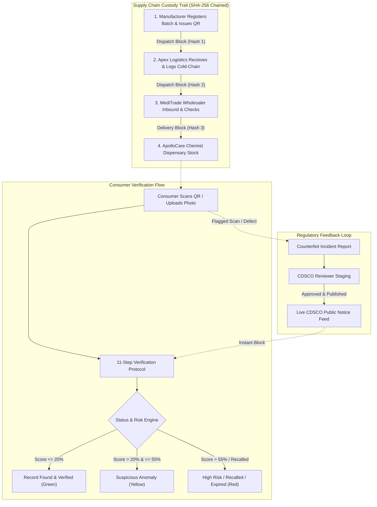

# MediSure AI — System Architecture, Workflows & Feature Documentation

> **Project:** MediSure AI (PBL5)  
> **Domain:** Pharmaceutical Authentication, CDSCO Regulatory Compliance & Supply Chain Traceability  
> **Tech Stack:** Next.js 16 (App Router, TypeScript, React 19), FastAPI (Python 3.11, SQLite / SQLAlchemy), SHA-256 Cryptographic Chaining

---

## 1. Executive Summary & Core Mission

**MediSure AI** is an end-to-end anti-counterfeiting and pharmaceutical verification platform built specifically for the Indian healthcare ecosystem. It bridges the critical gap between pharmaceutical manufacturers, logistics distributors, wholesale stockists, retail dispensaries, government regulators (CDSCO / State FDAs), and everyday consumers.

### Key Tenets
1. **Physical vs. Database Authenticity**: Differentiates between a QR code being merely present in a database versus a physically genuine, uncompromised product.
2. **Indian Regulatory Alignment**: Built around CDSCO Rule 96 (mandatory 2D barcodes on top 300 Indian medicine brands), Non-Standard Quality (NSQ) lab reports, and state drug licensing (FDA Maharashtra, Karnataka, Gujarat, Himachal Pradesh, etc.).
3. **Zero-Trust Cryptographic Ledger**: Implements SHA-256 block-chained custody verification from factory production to consumer dispensation.
4. **Instant Non-Account Consumer Verification**: Any patient or consumer can scan a strip QR code or enter a batch number without needing prior login or app installation.

---

## 2. Complete Stakeholder Roles & Portals

The platform implements Role-Based Access Control (RBAC) with 7 distinct stakeholder workflows:

| Role | Portal Route | Primary Capabilities |
| :--- | :--- | :--- |
| **Consumer / Patient** | `/dashboard`, `/scan`, `/verify/[id]` | Scan packaging QR, upload photos for OCR label parsing, inspect 11-step verification logs, review CDSCO alerts, report counterfeits. |
| **Pharmaceutical Manufacturer** | `/company` | Register medicine formulations, issue batches with cryptographic QR tokens, monitor scan anomalies (e.g. replay attacks), log factory dispatches. |
| **Distributor / Logistics** | `/distributor` | Confirm inbound factory shipments, log cold-chain temperature compliance, sign custody transfers on the SHA-256 ledger. |
| **Wholesaler / Stockist** | `/wholesaler` | Manage wholesale allocations to retail chemists, enforce automatic distribution blocks on expired/recalled batches. |
| **Retail Chemist / Pharmacy** | `/pharmacy` | Verify shelf stock, receive instant pop-up recall notices, one-click quarantine of flagged batches from dispensary shelves. |
| **CDSCO Regulatory Reviewer** | `/reviewer` | Staging queue to review laboratory test reports, publish NSQ alerts, official Class I/II recalls, and spurious drug warnings to the public feed. |
| **Platform Administrator** | `/admin` | System-wide surveillance metrics, monthly scan trends, stakeholder organization application approval/suspension, triage counterfeit reports. |

---

## 3. End-to-End System Workflows



### Workflow 1: Supply Chain Custody & Cryptographic Ledger
1. **Genesis Event (`batch_registered`)**:
   - QA Director registers batch on portal (e.g., `DOLO650-B25081`, 150,000 units).
   - Generates genesis SHA-256 block (`previous_hash = 0000...0000`).
2. **First Transit Event (`dispatch_recorded`)**:
   - Manufacturer dispatches batch to logistics partner (Apex Cold-Chain).
   - Payload includes consignment ID, quantity dispatched, container seal ID.
   - Block hash calculated from previous hash + event payload.
3. **Logistics Receiving (`shipment_received`)**:
   - Distributor scans carton QR upon arrival at central warehouse (Bhiwandi Hub).
   - Records datalogger mean temperature (e.g., `23.4°C` compliant).
4. **Wholesale Handoff (`dispatch_recorded` -> `shipment_received`)**:
   - Stockist (MediTrade) validates consignment and allocates units to retail chemists.
5. **Retail Pharmacy Dispensation (`dispensary_stock_entered`)**:
   - Registered pharmacist signs stock receipt; ready for patient dispensation.
6. **Ledger Integrity Check**:
   - Real-time audit verifies $\text{Hash}_i = \text{SHA-256}(\text{Hash}_{i-1} + \text{Payload}_i)$. Any broken link flags `TAMPER_DETECTED`.

---

### Workflow 2: Consumer 11-Step Verification Protocol

When a QR code, photo, or product code is submitted at `/scan`:

1. **Step 1 — Format & Structure Analysis**: Validates whether the QR payload conforms to GS1 DataMatrix or signed MediSure format.
2. **Step 2 — Cryptographic Token Signature**: Verifies tamper-evident digital token authenticity.
3. **Step 3 — Product Catalog Resolution**: Cross-checks brand name, generic salt composition (IP standards), and dosage against authorized database.
4. **Step 4 — Manufacturer Licence Verification**: Checks if the manufacturer holds a valid Form 25 / Form 28 licence issued by state drug controllers.
5. **Step 5 — Production Batch Validation**: Confirms the batch number was genuinely issued by the manufacturer for this specific formulation.
6. **Step 6 — Expiry & Shelf-Life Calculation**: Compares expiry date against current calendar date. Automatically flags expired medicines.
7. **Step 7 — Active CDSCO & State FDA Recall Check**: Cross-references batch and brand against published Class I/II recall orders.
8. **Step 8 — Non-Standard Quality (NSQ) Alert Cross-Reference**: Scans national drug testing laboratory test failures for active ingredient sub-potency or dissolution rate failures.
9. **Step 9 — High-Frequency Replay Anomaly Detection**: Monitors scan velocity. If a single consumer packaging token has been scanned abnormally across distant locations (e.g., Shelcal 500 scanned 184 times), flags a code cloning alert.
10. **Step 10 — Multi-Factor Risk Engine Scoring**: Computes a weighted risk score ($0$ to $100$) based on penalties from failed checks.
11. **Step 11 — 8-Class Result Classification**: Assigns official classification:
    - `record_found`: Valid batch, genuine manufacturer, intact seals.
    - `expired`: Batch past registered shelf-life.
    - `recalled`: Active CDSCO regulatory recall order.
    - `suspicious`: Scan frequency spike or visual packaging anomaly.
    - `revoked`: QR token invalidated by manufacturer.
    - `not_found`: Code or batch not registered in national database.
    - `unable_to_verify`: Connectivity or service disruption.
    - `verification_incomplete`: Partial check metadata available.

---

### Workflow 3: Regulatory Notice Publication & Enforcement
1. **Notice Ingestion**: Reviewer imports laboratory analysis reports or gazette orders into `/reviewer`.
2. **Staging State**: Notice remains in `In Staging` without disrupting active commerce.
3. **Authorized Review**: CDSCO auditor reviews laboratory findings (e.g., dissolution test failure) and clicks **Approve & Publish**.
4. **Immediate System-Wide Sync**:
   - Public feed at `/regulatory` displays the alert.
   - Retail pharmacies holding stock receive an immediate alert banner.
   - The 11-step verification engine instantly upgrades any scans of that batch to `recalled`.

---

### Workflow 4: Counterfeit Incident Reporting & Triage
1. **Submission**: Consumer or pharmacist spots suspicious packaging (blurry fonts, missing hologram, unusual symptoms) and submits a report at `/report`. Supports anonymous submission.
2. **Reference Issuance**: System generates unique tracking identifier (`MS-REP-2026-XXXX`).
3. **Admin Triage**: Administrators view flagged reports at `/admin?tab=reports`.
4. **Investigation Escalation**: Status transitions from `pending` -> `under_investigation` -> `verified_issue` -> `dismissed`.

---

## 4. Feature Index & Capabilities

### 🔍 Verification & Public Safety
- **Multi-Modal Scanner**: Camera QR scanning (`html5-qrcode`), packaging photo upload with simulated AI OCR label extraction, manual alphanumeric code entry, and 8 pre-configured academic demo scenarios.
- **Detailed Verification Report (`/verify/[id]`)**:
  - Verification badge, risk score meter (0–100%), and risk level indicator.
  - Medicine specification card (Brand, IP generic salt, strength, dosage form, packaging, storage).
  - 11-layer check accordion with granular Pass / Fail / Warning indicators.
  - Interactive cryptographic custody timeline with block sequence and SHA-256 hashes.
  - Actionable clinical guidance (safe to consume, quarantine, return to dispensary, report to drug inspector).
- **Public Medicine Registry (`/search`)**: Real-time fuzzy search by brand name, generic salt, or product code with therapeutic category filters.
- **CDSCO Safety Feed (`/regulatory`)**: Filter by NSQ Alerts, Official Recalls, Spurious Drug Alerts, and Prohibited Formulations. Direct links to official gazette PDFs.
- **Consumer Safety Guide (`/safety`)**: Visual checklist for blister foil inspection, typography verification, holographic security features, and state drug control helpline numbers.

### 🏢 Stakeholder Portals
- **Role-Based Auth Guard (`<AuthGuard />`)**: Protected routes with one-click accredited demo role switching for seamless academic evaluations.
- **Manufacturer Batch & QR Code Studio (`/company`)**:
  - Live CDSCO Rule 96 2D barcode & QR Code generator.
  - Multi-payload format exports (Direct verification URL, GS1/CDSCO JSON structure, or raw cryptographic security token).
  - High-resolution packaging PNG download & printable pharmaceutical blister carton labels.
  - One-click "Test Scan" provenance integration directly launching the 11-step verification engine.
  - Immediate QR Code modal pop-up on registering new batches.
- **Cold-Chain Logistics Management**: Inbound shipment manifest, datalogger temperature compliance monitoring (`<25°C`), custody receipt confirmation.
- **Wholesale Inventory Lock**: Automatic quarantine locks preventing the dispatch of expired or recalled units to chemists.
- **Pharmacy Dispensary Shelf**: Real-time shelf inventory with urgent CDSCO recall alerts and one-click shelf quarantine.
- **Admin Control Dashboard**: Recharts-powered monthly surveillance scan volume bar charts, risk distribution pie charts, top flagged drug leaderboards, and legal entity approval controls.

---

## 5. Demonstration Scenarios (Academic & Evaluator Testing)

| Demo Code | Medicine & Manufacturer | Scenario Behavior | Expected Classification |
| :--- | :--- | :--- | :--- |
| `DOLO650` | Dolo 650 (Micro Labs) | Authentic batch, intact custody trail, verified CoA | `record_found` (Low Risk, ~5%) |
| `AUG625DUO` | Augmentin 625 Duo (GSK) | Authentic formulation, verified cold chain | `record_found` (Low Risk, ~8%) |
| `PAND001` | Pan-D Capsules (Alkem) | Expired shelf-life (31 Dec 2024) | `expired` (Medium Risk, 62%) |
| `TELMA40` | Telma 40 (Glenmark) | Active CDSCO Class II dissolution stability recall | `recalled` (High Risk, 95%) |
| `AZITH500` | Azithral 500 (Alembic) | Visual packaging defect / typography anomaly | `suspicious` (Medium Risk, 48%) |
| `SHELCAL500` | Shelcal 500 (Torrent) | Token scanned 184 times across different cities | `suspicious` (Replay Alert, 78%) |
| `UNKNOWN` | Unregistered / Fake Token | Token not found in CDSCO / manufacturer database | `not_found` (High Risk, 100%) |

---

## 6. Directory & Code Architecture Reference

```
d:\PBL5\
├── backend/                  # FastAPI Python Service
│   ├── database.py           # SQLite connection & session
│   ├── main.py               # Application entrypoint & CORS
│   ├── models.py             # SQLAlchemy models (User, Medicine, Batch, Event, Notice, Report)
│   ├── schemas.py            # Pydantic validation schemas
│   ├── seed_data.py          # Real Indian pharma seed dataset (Micro Labs, GSK, Cipla, etc.)
│   └── routers/              # Modular API endpoints (auth, verify, medicines, reports, dashboard)
│
├── frontend/                 # Next.js 16 Web Application
│   ├── src/
│   │   ├── app/              # App Router Pages & API Route Handlers
│   │   │   ├── admin/        # System Administrator Governance Portal
│   │   │   ├── company/      # Pharmaceutical Manufacturer Portal
│   │   │   ├── distributor/  # Logistics & Cold-Chain Hub
│   │   │   ├── wholesaler/   # Wholesale Stockist Delivery Hub
│   │   │   ├── pharmacy/     # Retail Chemist Dispensary
│   │   │   ├── reviewer/     # CDSCO Regulatory Reviewer Workspace
│   │   │   ├── dashboard/    # Consumer Verification Overview
│   │   │   ├── scan/         # QR / Photo / Manual Scanner
│   │   │   ├── verify/[id]/  # 11-Step Verification Result & Audit Trail
│   │   │   ├── search/       # Public Medicine Catalog Search
│   │   │   ├── regulatory/   # Official CDSCO Recall & NSQ Notice Feed
│   │   │   ├── safety/       # Consumer Packaging Safety Guide
│   │   │   ├── report/       # Counterfeit Incident Report Form
│   │   │   ├── history/      # Personal Scan History
│   │   │   └── api/          # Internal Next.js API Routes (Serverless Endpoints)
│   │   ├── components/       # Shared UI (Navbar, Footer, AuthGuard, Badge, StatCard, Alert)
│   │   └── lib/              # Core logic (verificationEngine.ts, demoData.ts, auth.tsx, api.ts)
│   └── package.json
└── WORKFLOW_AND_FEATURES.md  # System Architecture & Workflow Specification (This Document)
```

